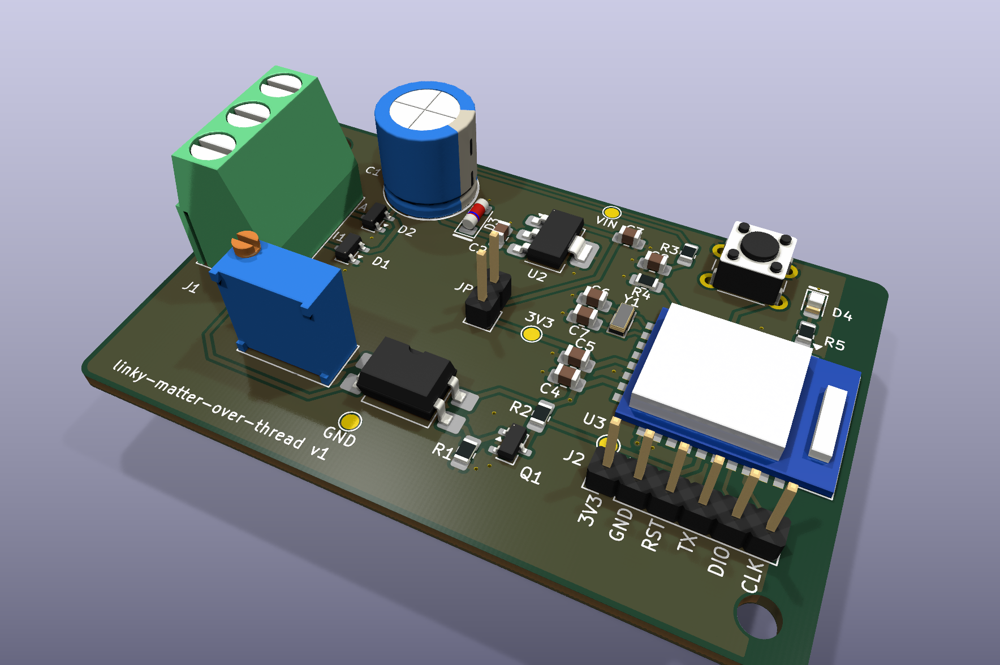
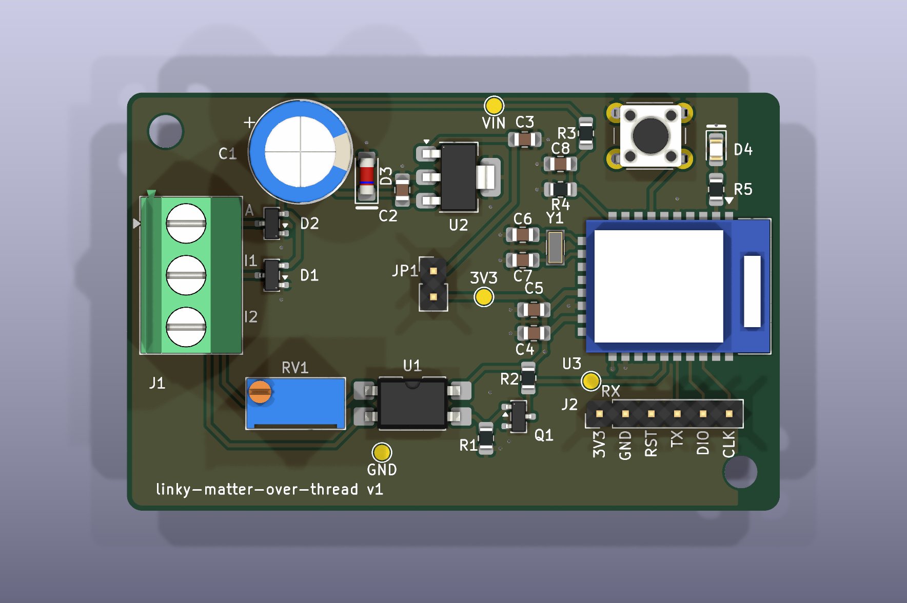
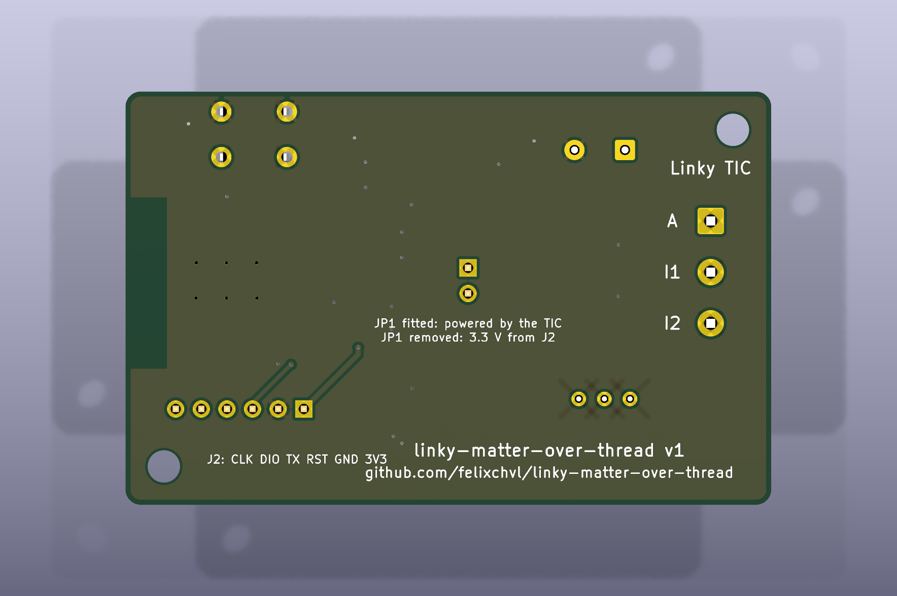
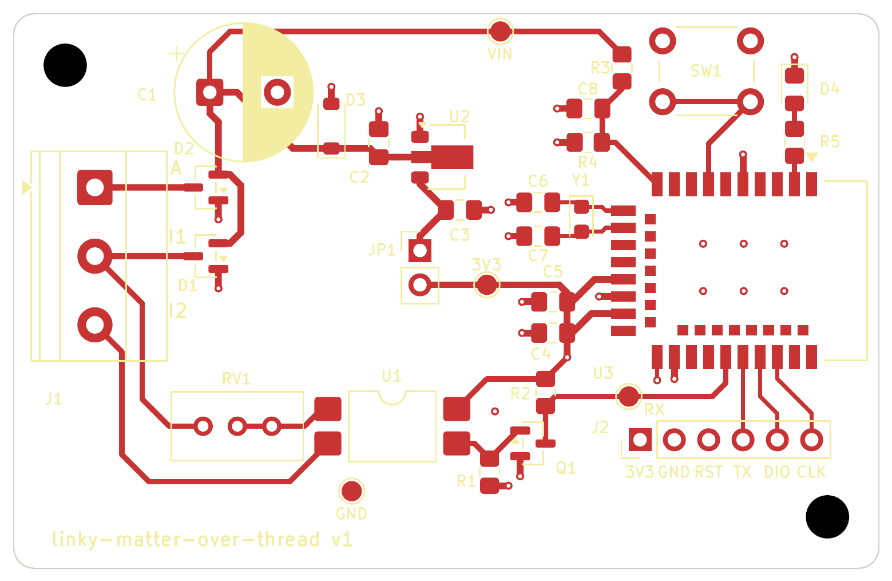
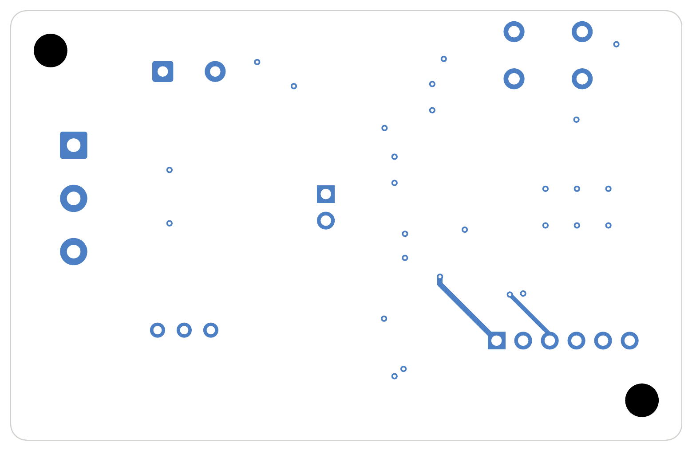

# linky-matter-over-thread

A small board that connects to the TIC output of a French Linky meter and makes its readings available over Thread, as a Matter device. It is powered by the meter itself, so there is no battery to replace and no power supply to run to the meter.



## Why I made it

I wanted my electricity usage in Home Assistant, live and without any cloud. The usual options are a Zigbee dongle (ZLinky), a Wi-Fi board that needs a USB supply next to the meter, or the Enedis website a day later. My home already runs a Thread network, and Home Assistant reads Matter energy measurements natively (kWh for the Energy dashboard, plus W, VA and V). So this board speaks Thread and Matter, and nothing else.

The closest thing I found is [BDeliers' Elektor Labs entry](https://www.elektormagazine.com/labs/the-electric-meter-that-matters) from 2024, which runs Matter over Thread on an STM32WB dev kit. The kit draws more than the TIC can supply, so it needs its own power. Running from the meter alone is the whole point of this one.

## Status

- [x] Schematic, v1
- [x] PCB layout, v1 (DRC clean, matches the schematic)
- [ ] First boards ordered and soldered
- [ ] Firmware (Zephyr / nRF Connect SDK, Matter over Thread)
  - [x] TIC decoder for both modes, with host tests
  - [x] Board definition and Matter application, building with nRF Connect SDK v3.4.2
  - [x] Energy per tariff index in Matter (HC/HP, Tempo, up to 10 indexes)
  - [ ] Running on a real board
- [x] Case designed in FreeCAD, checked against the board's 3D model (not printed yet)

Nothing has been built yet, so treat it as a design in progress. Read the checklist under [Building one](#building-one) before ordering.

## How it works

The TIC output has three screw terminals. I1 and A provide a little power (at least 130 mW, 6 V rms at 50 kHz). I1 and I2 carry the data as a 50 kHz carrier: carrier present means bit 0. The format is 7E1, at 1200 baud in "historique" mode or 9600 baud in "standard" mode.

**Power.** Two BAT54S form a Schottky bridge on I1–A. A 20 V zener keeps the input well under the 28 V limit of the regulator. A 470 µF capacitor covers the radio's transmit peaks, and a Microchip MCP1804 LDO (SOT-223) makes 3.3 V. With a linear regulator, current is what matters: the TIC can deliver roughly 16–20 mA, and the board should average 1–2 mA as a sleepy Thread device. JP1 links the regulator to the 3.3 V rail. Pull it to run the board from the programming header, or to put an ammeter in its place.

**Data.** The receiver is the stage from Charles-Henri Hallard's PiTInfo V1.2: a 2 kΩ trimmer, an LTV-814 optocoupler and a small N-MOSFET (an AO3400A here, a CJ2302 on the PiTInfo). When the carrier is present, TIC_RX goes low, so the UART reads the bits without any inversion. The nRF52840 UART has no 7-bit mode, so the firmware reads 8 bits, checks the parity bit itself and drops it. On top of that, the checksum at the end of each TIC line catches errors.

**Radio.** The radio is an Ebyte E73-2G4M08S1C module with an nRF52840:
- normal voltage mode (VDDH tied to VDD), USB unused;
- a 32.768 kHz crystal (9 pF load, 3.2 × 1.5 mm) with 10 pF capacitors, for accurate wake-ups while sleeping. Nordic's reference uses 12 pF, which Reichelt does not stock; the lighter load runs the crystal about 35 ppm fast, so the firmware declares a 75 ppm clock instead of 50;
- only the 28 castellated pads on the module's edge are used, so it solders with a regular iron; the 15 pads underneath stay unconnected.

The firmware will also read its own input voltage through a divider on AIN6. It will run as a sleepy end device by default, and only become a Thread router if the measured margin allows it.

## Pin assignment

| Signal | nRF52840 | E73 pad |
| --- | --- | --- |
| TIC_RX (UART RX) | P0.13 | 33 |
| Debug UART TX | P0.24 | 35 |
| VIN_SENSE (VIN × 0.13) | P0.30 / AIN6 | 10 |
| Button (to GND, internal pull-up) | P0.02 | 7 |
| LED (active high) | P1.10 | 2 |
| 32.768 kHz crystal | P0.00, P0.01 | 11, 13 |
| Reset | P0.18 | 26 |
| SWDIO, SWDCLK | | 37, 39 |

J2 is a 2.54 mm header, in the same order as the module pads: 3V3, GND, RST, TX, DIO, CLK.

## Files

```
hardware/
  linky-matter-over-thread.kicad_pro, .kicad_sch, .kicad_pcb  KiCad 10 project
  linky-matter-over-thread.kicad_sym, .pretty/                E73 symbol and footprint
  linky-matter-over-thread.3dshapes/                          simplified 3D model of the module
  production/linky-matter-over-thread-gerbers.zip             Gerbers and drill files
  production/bom.csv                                          parts list with Reichelt article numbers
firmware/                                                   Zephyr / nRF Connect SDK app, see firmware/README.md
case/                                                       3D-printed enclosure (FreeCAD), see case/README.md
docs/
  schematic.pdf
  images/
```

| Top | Bottom |
| --- | --- |
|  |  |

The copper alone, with the ground pour hidden so the tracks are easy to follow. The bottom layer is seen through the board, in the same orientation as the top.

| Top copper | Bottom copper |
| --- | --- |
|  |  |

The full schematic is in [docs/schematic.pdf](docs/schematic.pdf).

## Building one

The board is 64 × 41 mm, two layers, 1.6 mm. The Gerber zip can be uploaded as is to JLCPCB or any other fab.

Tracks are 0.5 mm for power and ground, 0.4 mm for signals and 0.3 mm on the module's pads, with at least 0.25 mm between copper, well clear of standard process limits. The rules are saved in the KiCad project (Default and Power netclasses), so edits in KiCad pick them up.

Before ordering:

- The E73 footprint is drawn from Ebyte's drawing. Its pads match the [SnapEDA footprint](https://github.com/rbaron/b-parasite/tree/main/kicad/lib/snapeda) and [nordic-lib-kicad](https://github.com/hlord2000/nordic-lib-kicad) exactly, and [nrfmicro](https://github.com/joric/nrfmicro)'s within 0.2 mm, but it has not met a physical module yet. If you have one, print [docs/footprint-check-1to1.pdf](docs/footprint-check-1to1.pdf) at 100 % (its two scale bars tell you if the printer resized it) and lay the module on it.
- The E73 is no longer listed at LCSC. I buy it from Passion Radio in France; Ebyte also sells it on Tindie and AliExpress, and RobotShop stocks it.
- Every other part is stocked by Reichelt, an EU distributor. I picked it on purpose: since 2026, small parcels from China into France pay a flat customs fee per type of item, which costs more than the parts on an order like this one.

Parts:

- **[production/bom.csv](hardware/production/bom.csv)** has every part with a manufacturer part number and its Reichelt article number.
- **Passives:** generic 0805, any equivalent works.
- **Regulator:** the MCP1804 takes up to 28 V in (30 V absolute), which leaves a wide margin over the 20 V zener.

Soldering:

- All SMD parts are 0805, SOT-23, SOT-223, MiniMELF or a 3.2 × 1.5 mm crystal, with hand-soldering pads where KiCad has them.
- The 3.2 × 1.5 mm crystal and the 0805 parts are the smallest; a fine tip is enough, hot air helps.

Before connecting it to the meter:

- Set RV1 to about 1–1.2 kΩ. The TIC wants 500–2000 Ω on its data pair, and 1–1.2 kΩ is what people report working on Linky.
- Wire A, I1 and I2 as printed next to the terminal. I1 is in the middle because it feeds both the power bridge and the receiver, so the order differs from the meter's.
- Never feed 3.3 V into J2 while JP1 is fitted.

The module is programmed over SWD through J2, with a J-Link or a Raspberry Pi Pico running [debugprobe](https://github.com/raspberrypi/debugprobe).

## Credits

- The TIC receiver comes from [PiTInfo](https://github.com/hallard/teleinfo) by Charles-Henri Hallard.
- The electrical and frame details come from the Enedis TIC specification, Enedis-NOI-CPT_54E.
- The module pinout and pad drawing come from the Ebyte E73-2G4M08S1C user manual.
- Decoding in the firmware will start from [zephyr-linky-tic](https://github.com/lucasdietrich/zephyr-linky-tic) by Lucas Dietrich.

## License

The hardware design (everything outside `firmware/`) is shared under [CC BY-NC-SA 4.0](LICENSE), the same license as the PiTInfo design it builds on.

The firmware is under the [Apache License 2.0](firmware/LICENSE), like Zephyr.
