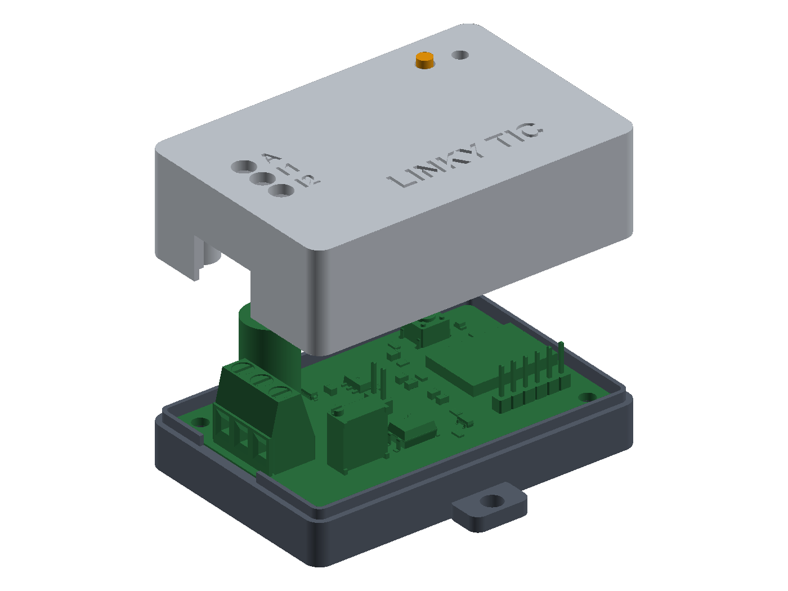
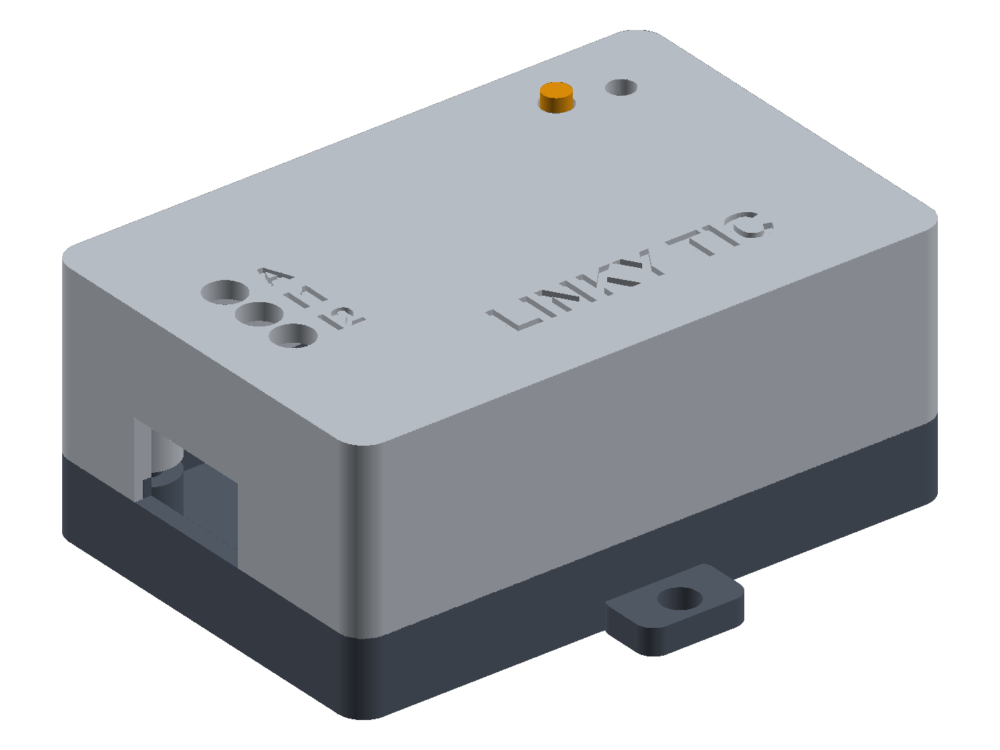

# Enclosure

Two printed parts and a small plunger for the pairing button. The box is 69 × 46 × 29 mm, or 60 mm wide with its two mounting ears.



| Closed | Lid from above |
| --- | --- |
|  |  |

It has not been printed yet.

## Printing

| Part | File | Orientation |
| --- | --- | --- |
| Base | `linky_case_base.stl` | on its floor |
| Lid | `linky_case_lid.stl` | upside down, on its top |
| Plunger | `linky_case_plunger.stl` | on its flange |

The STL files are already in these orientations, so nothing needs supports.

I plan to use PETG or ASA, 0.2 mm layers, 3 walls and 20 % infill. PLA works too, but it softens in a warm meter cupboard.

## Assembly

You need two M3 × 16 socket head screws. The lid pillars have 2.6 mm pilot holes, so the screws cut their own thread in PETG. Two more screws of up to 4 mm can go through the ears to fix the box to a wall.

1. Drop the plunger into its guide tube from inside the lid, flange first.
2. Set the board on the base, with the terminal block on the side with the wire opening.
3. Put the lid on and drive the two screws in from below. They go through the base, the board and into the lid, so the board is clamped between them.
4. Pass the three TIC wires through the opening and tighten them through the holes in the lid. The holes are labelled A, I1 and I2, in the board's order, which is not the meter's.

JP1, the trimmer and the programming header are only reachable with the lid off.

## How it is made

`make_case.py` builds everything with FreeCAD's Python API. To regenerate the files, from the repository root:

```
kicad-cli pcb export step --subst-models -o case/build/board.step hardware/linky-matter-over-thread.kicad_pcb
freecadcmd case/make_case.py
```

When `case/build/board.step` is there, the script also checks that no part of the board touches the enclosure, then renders the previews. KiCad's model of C1 is shorter than the real 10 × 16 mm capacitor, so the check uses a cylinder of the real size instead. The last run found:
- no overlap with any of the three parts;
- 1.4 mm between C1 and the roof;
- 0.3 mm between the plunger and the button.

The labels use Arial Bold from macOS. On another system, change the font path in `text()`.
